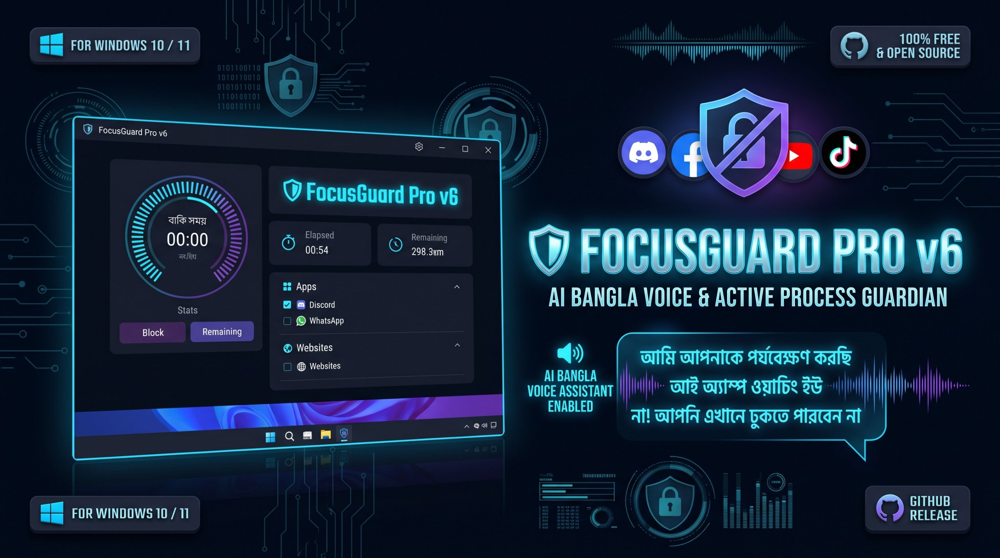
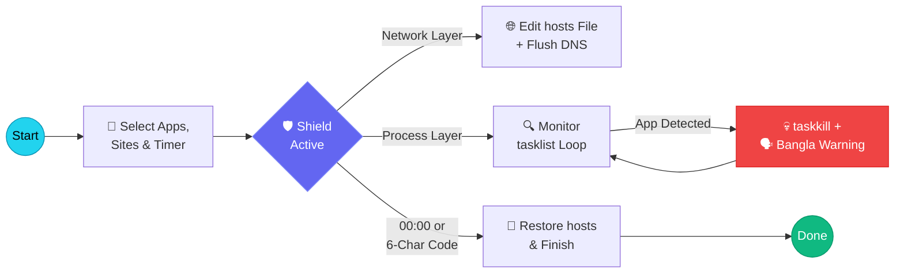
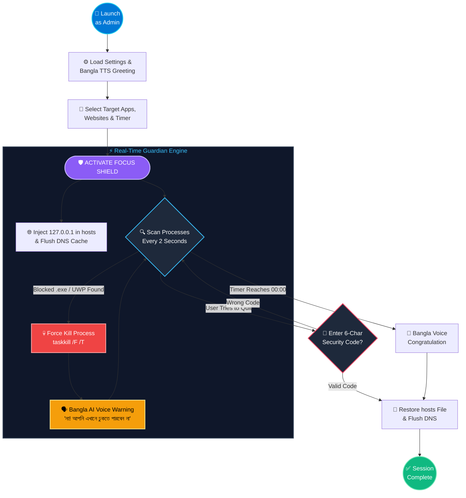

# FocusGuard-Pro

<div align="center">



<br><br>

# 🛡️ FocusGuard Pro v6

lock distractions. Stay locked in. Get told off — in Bangla.

An all-in-one Windows focus tool that kills distracting apps, blocks websites at the system level,
and watches over you with a real-time **Bangla AI voice assistant**.

<br>

[](https://www.python.org/)
[](#-installation)
[](#-tech-stack)
[](#-bangla-ai-voice-guardian)
[](LICENSE)
[](#-tech-stack)

**[⬇️ Download](https://github.com/BUGHUNTER-71/FocusGuard-Pro/releases)** ·
**[✨ Features](#-features)** ·
**[🚀 Quick Start](#-installation)** ·
**[❓ FAQ](#-faq)** ·
**[🗺️ Roadmap](#%EF%B8%8F-roadmap)**

</div>

---

## 🎯 Why FocusGuard Pro?

Most blockers just hide a website behind a warning page, and you can turn them off with one click.
FocusGuard Pro is built around the idea that **willpower fails at 2 AM**, so it:

- 🔒 **Enforces** the block at the OS level (processes + `hosts` file), not just in the browser
- 🗣️ **Talks to you** in Bangla, so it feels like a study partner and not a nagging popup
- 🧱 **Makes quitting hard** with a random security code you must type to abort early
- 📦 **Needs nothing extra** — pure Python standard library, no `pip install`

---

## ✨ Features

### 🎙️ Bangla AI Voice Guardian
Powered by Google Translate TTS and the Windows `MediaPlayer`.

| Moment | What it does |
|---|---|
| **Startup** | Greets you out loud |
| **Session begins** | Announces that monitoring has started |
| **You open a blocked app** | Warns you: *"না! আপনি এখানে ঢুকতে পারবেন না…"* ("No! You can't go in here…") |
| **Timer completes** | Congratulates you on finishing |

> Works even if your Windows username contains spaces.

### 💻 Smart Desktop & UWP App Blocker
- Terminates distracting `.exe` processes in real time using `tasklist` and `taskkill /F /T`
- **UWP alias detection** for Microsoft Store apps, e.g. blocking `WhatsApp.exe` also catches `WhatsApp.Root.exe`
- Tick the apps you want blocked right from the dashboard (Discord, WhatsApp and more)

### 🌐 System-Level Website & Social Media Blocker
- Redirects sites to `127.0.0.1` through the Windows `hosts` file
- Flushes the DNS cache automatically (`ipconfig /flushdns`)
- Works across **all browsers**: YouTube, Facebook, Instagram, TikTok, Netflix and more

### ⏱️ Futuristic Chrono Dashboard
- High-DPI dark-mode UI with an **animated radial progress gauge**
- Quick timer presets from `15m` to `120m`
- Live **Elapsed** and **Remaining** counters
- Settings saved automatically to `focus_config_v6.json`

### 🚨 Emergency Override Protection
No closing the window on impulse. Quitting mid-session requires typing a
**randomly generated 6-character alphanumeric code**.

---


## 🧠 How It Works



## 🧠 How It Works (System Architecture & Flow)



## 🛠️ Tech Stack

| Component | Technology / Windows API |
|---|---|
| **Core language** | Python 3.x (zero third-party `pip` dependencies) |
| **User interface** | `tkinter` with `ctypes` High-DPI awareness (`SetProcessDpiAwareness`) |
| **Process control** | Windows `tasklist`, `taskkill` and `subprocess` |
| **Web filtering** | Windows `hosts` file injection + `ipconfig /flushdns` |
| **Bangla voice TTS** | Google Translate TTS API + PowerShell `System.Windows.Media.MediaPlayer` (`presentationCore`) |

---

## 🚀 Installation

> [!IMPORTANT]
> **Run as Administrator.** FocusGuard needs it to edit the Windows `hosts` file and terminate background processes.

**Requirements:** Windows 10 / 11 · Python 3.8+ · internet connection (only for Bangla voice lines)

### 1️⃣ Clone the repository
```bash
git clone https://github.com/BUGHUNTER-71/FocusGuard-Pro.git
cd FocusGuard-Pro
```

### 2️⃣ Launch it
Right-click the included **`.bat`** launcher and choose **Run as administrator**, or from an
elevated terminal:

```bash
python focusguard.py
```
<!-- TODO: replace focusguard.py with your real script name, and name your .bat launcher above -->

### 3️⃣ Use it
1. Tick the **apps** and **websites** you want blocked
2. Choose a timer preset (15 – 120 min)
3. Press **Block** and get to work 🎧

---

## 📸 Preview

<div align="center">

<!-- Replace with a real screenshot:  -->

*Dashboard: radial timer gauge, Elapsed / Remaining counters, and the app & website block lists.*

</div>

---

## ❓ FAQ

<details>
<summary><b>Does it work on macOS or Linux?</b></summary>

No. It relies on Windows-only tools (`tasklist`, `taskkill`, the Windows `hosts` path and PowerShell media APIs).
</details>

<details>
<summary><b>Why does it need Administrator rights?</b></summary>

Editing `C:\Windows\System32\drivers\etc\hosts` and force-closing other processes are privileged operations.
</details>

<details>
<summary><b>Do I need internet?</b></summary>

Blocking works offline. Only the Bangla voice lines need a connection, because they come from Google Translate TTS.
</details>

<details>
<summary><b>What if the app crashes mid-session?</b></summary>

Blocked sites live in your `hosts` file, so check that file and remove the FocusGuard entries if a session ended
abnormally. <!-- TODO: confirm how your app marks/cleans its entries and describe it here -->
</details>

<details>
<summary><b>Will antivirus flag it?</b></summary>

Tools that edit `hosts` and kill processes can trigger heuristic warnings. The source is fully open, so read it before you run it.
</details>

---

## 🗺️ Roadmap

- [ ] Custom app / website lists from the UI
- [ ] Packaged `.exe` installer in [Releases](https://github.com/BUGHUNTER-71/FocusGuard-Pro/releases)
- [ ] Session history & focus statistics
- [ ] Offline voice lines (cached audio)
- [ ] System tray mode
- [ ] More voice languages

Have an idea? [Open an issue](https://github.com/BUGHUNTER-71/FocusGuard-Pro/issues) 💡

---

## 🤝 Contributing

Contributions, issues and feature requests are welcome.

1. Fork the repo
2. Create your branch: `git checkout -b feature/amazing-idea`
3. Commit: `git commit -m "Add amazing idea"`
4. Push and open a Pull Request

---

## ⚠️ Disclaimer

FocusGuard Pro modifies your system `hosts` file and terminates processes you select. Use it responsibly and
at your own risk.

## 📄 License

Released under the **MIT License**. See [`LICENSE`](LICENSE) for details.

---

<div align="center">

### Made with ❤️ by [BUGHUNTER-71](https://github.com/BUGHUNTER-71)

If FocusGuard Pro helped you focus, **drop a ⭐ on the repo** — it means a lot for a first project!

</div>
